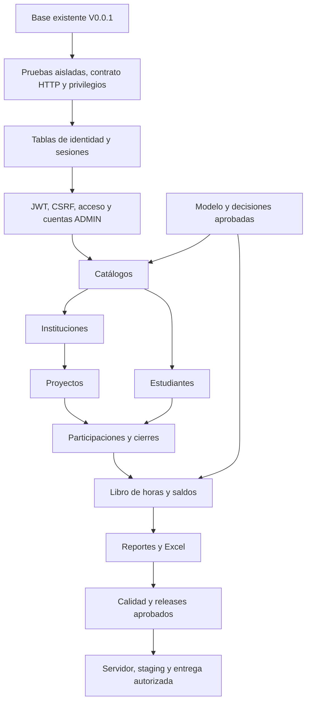

# Índice de issues y dependencias

Fecha: 25 de octubre de 2026. [Hoja de ruta en GitHub](https://github.com/Luisnativii/ServicioHorasSociales/issues/4).

El plan se desglosa en **95 tareas pequeñas y 10 hitos**. Se reutilizan #1 (base implementada) y #2 (aceptación manual pendiente). La documentación actual se prepara en #3. Cada tarea tiene prompt, criterios y límites propios.

**Estado de fuentes (26 de octubre de 2026):** #3 ya está integrado en V0.0.2. El propietario confirmó la lógica del contexto y autorizó omitir otra exportación. #5 consolida [fuentes y decisiones](FUENTES_Y_TRAZABILIDAD.md), [reglas](REGLAS_CONSOLIDADAS.md) y un [modelo nuevo propuesto](MODELO_DATOS_PROPUESTO.md); el v0.2 no se recuperó. La propuesta aún requiere revisión y no desbloquea por sí sola migraciones ni decisiones abiertas.

**Aclaración vigente:** múltiples cuentas administradoras, un único rol ADMIN con acceso completo y autenticación JWT. Las frases del plan original que limitan a una cuenta están sustituidas.

## Cómo escoger la siguiente tarea

1. Leer un solo issue y comprobar sus dependencias nativas en GitHub, junto con la aceptación de sus fuentes/decisiones.
2. Verificar que el cambio requerido está integrado en `develop`; una rama o PR abierto no basta.
3. Aplicar `status:ready` solo cuando se decida empezar una tarea desbloqueada. El resto permanece en backlog sin crear ramas.
4. Usar su prompt junto con [CONTEXTO_IA.md](CONTEXTO_IA.md), consultando solo el modelo/etapa necesarios. No pegar todo el roadmap en cada sesión.
5. Probar el cambio en Docker, preparar el PR y detenerse antes de iniciar otra tarea.

Las dependencias nativas y el estado de los issues en GitHub son la referencia viva. Las tablas siguientes son un índice inicial, no una afirmación de que las tareas ya estén aceptadas. La mejora #19 añadirá la comprobación automática de estos bloqueos al inicio/merge; mientras tanto se revisan expresamente.

## Secuencia principal

Este esquema resume módulos; las dependencias precisas están en cada issue. Estudiantes puede avanzar aparte de proyectos cuando sus fuentes y catálogos están listos. Autenticación necesita su contrato e identidad mínima, no todas las tablas de negocio.

## Avance ya existente

- #1 — inicialización Docker, esquema vacío, salud real, persistencia y CI: implementado y verificado automáticamente.
- #2 — validación manual inicial: abierta en su rama existente; no se sustituye ni se da por aprobada.
- #3 — publicación de fuentes, instrucciones compartidas e índice de esta planeación mediante PR de documentación.

## 00 · Fuentes y decisiones

Consolidar fuentes, reglas aprobadas y bloqueos. La documentación no equivale a autorizar implementaciones.

[Ver hito en GitHub](https://github.com/Luisnativii/ServicioHorasSociales/milestone/1) · 10 tareas nuevas.

| Issue | Resultado acotado | Depende de |
| --- | --- | --- |
| [#5](https://github.com/Luisnativii/ServicioHorasSociales/issues/5) | docs: consolidar lógica de negocio, modelo v0.2 y entrevistas | #3 |
| [#6](https://github.com/Luisnativii/ServicioHorasSociales/issues/6) | docs: fijar alcance vigente, trabajo previo y reglas transversales | #3 |
| [#7](https://github.com/Luisnativii/ServicioHorasSociales/issues/7) | docs: confirmar cardinalidad e historia de tipos y áreas | #5, #6 |
| [#8](https://github.com/Luisnativii/ServicioHorasSociales/issues/8) | docs: aprobar estados y reglas de cierre de participaciones | #5, #6 |
| [#9](https://github.com/Luisnativii/ServicioHorasSociales/issues/9) | docs: aprobar correcciones del libro de horas y casos tras cierre | #5, #6 |
| [#10](https://github.com/Luisnativii/ServicioHorasSociales/issues/10) | docs: aprobar corte, procedencia e idempotencia de saldos previos | #5, #6 |
| [#11](https://github.com/Luisnativii/ServicioHorasSociales/issues/11) | docs: aprobar contactos y asociaciones de coordinadores | #5, #6 |
| [#12](https://github.com/Luisnativii/ServicioHorasSociales/issues/12) | docs: aprobar historia académica y clasificación temporal de reportes | #5, #6, #7 |
| [#13](https://github.com/Luisnativii/ServicioHorasSociales/issues/13) | docs: resolver alcance de modalidad y habilidades blandas | #5, #6 |
| [#14](https://github.com/Luisnativii/ServicioHorasSociales/issues/14) | docs: inventariar equipo objetivo y acordar metas de calidad | #6 |

## 01 · Base técnica y pruebas aisladas

Reutilizar V0.0.1; completar solo brechas de ambientes, contrato HTTP y privilegios de base.

[Ver hito en GitHub](https://github.com/Luisnativii/ServicioHorasSociales/milestone/2) · 5 tareas nuevas.

| Issue | Resultado acotado | Depende de |
| --- | --- | --- |
| [#15](https://github.com/Luisnativii/ServicioHorasSociales/issues/15) | ci: aislar PostgreSQL y herramientas en hs-test | #3 |
| [#16](https://github.com/Luisnativii/ServicioHorasSociales/issues/16) | chore: completar límites y operación local de contenedores | #3 |
| [#17](https://github.com/Luisnativii/ServicioHorasSociales/issues/17) | feat(api): establecer contrato común de errores y paginación | #15 |
| [#18](https://github.com/Luisnativii/ServicioHorasSociales/issues/18) | chore(db): separar privilegios de migración y aplicación | #15 |
| [#19](https://github.com/Luisnativii/ServicioHorasSociales/issues/19) | ci: impedir iniciar o integrar tareas con dependencias pendientes | #3 |

## 02 · Administradores, JWT y acceso

Varias cuentas, un solo rol ADMIN con acceso completo; autenticación y sesiones revocables antes del negocio.

[Ver hito en GitHub](https://github.com/Luisnativii/ServicioHorasSociales/milestone/3) · 14 tareas nuevas.

| Issue | Resultado acotado | Depende de |
| --- | --- | --- |
| [#20](https://github.com/Luisnativii/ServicioHorasSociales/issues/20) | docs: definir contrato de múltiples ADMIN y sesiones JWT | #6 |
| [#21](https://github.com/Luisnativii/ServicioHorasSociales/issues/21) | feat(auth): migrar administradores y generar consultas sqlc | #20, #18, #15 |
| [#22](https://github.com/Luisnativii/ServicioHorasSociales/issues/22) | feat(auth): persistir sesiones administrativas revocables | #21 |
| [#23](https://github.com/Luisnativii/ServicioHorasSociales/issues/23) | feat(auth): crear y recuperar cuentas ADMIN desde Docker | #21, #22, #20 |
| [#24](https://github.com/Luisnativii/ServicioHorasSociales/issues/24) | feat(auth): validar JWT y sesión revocable en middleware | #20, #22, #17 |
| [#25](https://github.com/Luisnativii/ServicioHorasSociales/issues/25) | feat(auth): proteger cookies y mutaciones contra CSRF | #20, #17 |
| [#26](https://github.com/Luisnativii/ServicioHorasSociales/issues/26) | feat(auth): implementar login y consulta de identidad | #23, #24, #25 |
| [#27](https://github.com/Luisnativii/ServicioHorasSociales/issues/27) | feat(auth): rotar renovación y detectar reutilización | #26, #22, #25 |
| [#28](https://github.com/Luisnativii/ServicioHorasSociales/issues/28) | feat(auth): cerrar sesión y comprobar revocación inmediata | #27 |
| [#29](https://github.com/Luisnativii/ServicioHorasSociales/issues/29) | feat(auth): administrar cuentas con un solo rol ADMIN | #28, #20 |
| [#30](https://github.com/Luisnativii/ServicioHorasSociales/issues/30) | feat(web): centralizar sesión, CSRF y renovación concurrente | #27, #28 |
| [#31](https://github.com/Luisnativii/ServicioHorasSociales/issues/31) | feat(web): crear pantalla real de acceso administrativo | #30, #26, #25 |
| [#32](https://github.com/Luisnativii/ServicioHorasSociales/issues/32) | feat(web): proteger navegación y crear layout administrativo | #31, #28 |
| [#33](https://github.com/Luisnativii/ServicioHorasSociales/issues/33) | feat(web): gestionar cuentas administradoras desde la interfaz | #32, #29 |

## 03 · Catálogos y configuración

Configuración académica, territorio, clasificación y coordinadores conforme al modelo aprobado.

[Ver hito en GitHub](https://github.com/Luisnativii/ServicioHorasSociales/milestone/4) · 12 tareas nuevas.

| Issue | Resultado acotado | Depende de |
| --- | --- | --- |
| [#34](https://github.com/Luisnativii/ServicioHorasSociales/issues/34) | feat(catalogos): migrar estructura académica aprobada | #5, #18, #21 |
| [#35](https://github.com/Luisnativii/ServicioHorasSociales/issues/35) | feat(catalogos): exponer configuración académica protegida | #34, #28, #17 |
| [#36](https://github.com/Luisnativii/ServicioHorasSociales/issues/36) | feat(web): administrar facultades y carreras con datos reales | #35, #32 |
| [#37](https://github.com/Luisnativii/ServicioHorasSociales/issues/37) | chore(db): cargar catálogo territorial verificado e idempotente | #5, #18 |
| [#38](https://github.com/Luisnativii/ServicioHorasSociales/issues/38) | feat(catalogos): consultar jerarquía territorial desde la API | #37, #28, #17 |
| [#39](https://github.com/Luisnativii/ServicioHorasSociales/issues/39) | feat(web): reutilizar selector territorial dependiente | #38, #32 |
| [#40](https://github.com/Luisnativii/ServicioHorasSociales/issues/40) | feat(catalogos): persistir tipos y áreas según cardinalidad aprobada | #7, #18 |
| [#41](https://github.com/Luisnativii/ServicioHorasSociales/issues/41) | chore(catalogos): incorporar las áreas y tipos revisados | #40, #7, #5 |
| [#42](https://github.com/Luisnativii/ServicioHorasSociales/issues/42) | feat(catalogos): administrar tipos y áreas con validación | #40, #28, #17 |
| [#43](https://github.com/Luisnativii/ServicioHorasSociales/issues/43) | feat(web): mantener tipos y áreas desde configuración | #42, #41, #32 |
| [#44](https://github.com/Luisnativii/ServicioHorasSociales/issues/44) | feat(catalogos): persistir coordinadores y vínculos académicos | #11, #34, #28 |
| [#45](https://github.com/Luisnativii/ServicioHorasSociales/issues/45) | feat(web): administrar coordinadores y sus carreras | #44, #36, #32 |

## 04 · Instituciones u organizaciones

Instituciones, sedes y contactos; distinguirlas del lugar y responsable de ejecución del proyecto.

[Ver hito en GitHub](https://github.com/Luisnativii/ServicioHorasSociales/milestone/5) · 4 tareas nuevas.

| Issue | Resultado acotado | Depende de |
| --- | --- | --- |
| [#46](https://github.com/Luisnativii/ServicioHorasSociales/issues/46) | feat(instituciones): migrar organizaciones y sede institucional | #5, #11, #37, #18 |
| [#47](https://github.com/Luisnativii/ServicioHorasSociales/issues/47) | feat(instituciones): exponer altas y consultas paginadas | #46, #28, #17 |
| [#48](https://github.com/Luisnativii/ServicioHorasSociales/issues/48) | feat(instituciones): gestionar contactos sin mezclarlos con proyectos | #47, #11 |
| [#49](https://github.com/Luisnativii/ServicioHorasSociales/issues/49) | feat(web): crear módulo de instituciones y contactos | #48, #39, #32 |

## 05 · Proyectos y estudiantes

CRUD y ciclos propios; estudiantes pueden avanzar en paralelo tras catálogos y decisiones académicas.

[Ver hito en GitHub](https://github.com/Luisnativii/ServicioHorasSociales/milestone/6) · 9 tareas nuevas.

| Issue | Resultado acotado | Depende de |
| --- | --- | --- |
| [#50](https://github.com/Luisnativii/ServicioHorasSociales/issues/50) | feat(proyectos): migrar proyectos y clasificación aprobada | #46, #40, #37, #7, #11, #5 |
| [#51](https://github.com/Luisnativii/ServicioHorasSociales/issues/51) | feat(proyectos): implementar registro, edición y búsqueda | #50, #28, #17 |
| [#52](https://github.com/Luisnativii/ServicioHorasSociales/issues/52) | feat(web): crear formularios y consulta de proyectos | #51, #49, #43, #39, #45, #32 |
| [#53](https://github.com/Luisnativii/ServicioHorasSociales/issues/53) | feat(proyectos): aplicar cierres e historial transaccional | #51, #8, #12 |
| [#54](https://github.com/Luisnativii/ServicioHorasSociales/issues/54) | feat(web): confirmar cierre de proyecto y mostrar historial | #52, #53 |
| [#55](https://github.com/Luisnativii/ServicioHorasSociales/issues/55) | feat(estudiantes): migrar expediente y carnet como texto | #34, #5, #12, #18 |
| [#56](https://github.com/Luisnativii/ServicioHorasSociales/issues/56) | feat(estudiantes): crear búsqueda y edición académica protegida | #55, #28, #17, #12 |
| [#57](https://github.com/Luisnativii/ServicioHorasSociales/issues/57) | feat(web): crear listado y formulario de estudiantes | #56, #36, #32 |
| [#58](https://github.com/Luisnativii/ServicioHorasSociales/issues/58) | feat(web): preparar expediente con estados vacíos reales | #57 |

## 06 · Participaciones y horas

Asignación, abandono, cierres, libro de horas, saldos y correcciones aprobadas.

[Ver hito en GitHub](https://github.com/Luisnativii/ServicioHorasSociales/milestone/7) · 15 tareas nuevas.

| Issue | Resultado acotado | Depende de |
| --- | --- | --- |
| [#59](https://github.com/Luisnativii/ServicioHorasSociales/issues/59) | feat(participaciones): migrar vínculos e historial por estudiante | #55, #50, #8, #18 |
| [#60](https://github.com/Luisnativii/ServicioHorasSociales/issues/60) | feat(participaciones): asignar alumnos con cupo informativo | #59, #53, #28 |
| [#61](https://github.com/Luisnativii/ServicioHorasSociales/issues/61) | feat(web): asignar estudiantes desde proyecto y expediente | #60, #52, #58 |
| [#62](https://github.com/Luisnativii/ServicioHorasSociales/issues/62) | feat(participaciones): registrar abandono y detectar abandono total | #60, #8 |
| [#63](https://github.com/Luisnativii/ServicioHorasSociales/issues/63) | feat(web): confirmar abandono individual y mostrar sus efectos | #62, #61 |
| [#64](https://github.com/Luisnativii/ServicioHorasSociales/issues/64) | feat(participaciones): coordinar cierre de proyecto y participantes | #62, #53, #8 |
| [#65](https://github.com/Luisnativii/ServicioHorasSociales/issues/65) | feat(horas): crear libro de movimientos e índices de trazabilidad | #59, #12, #18 |
| [#66](https://github.com/Luisnativii/ServicioHorasSociales/issues/66) | feat(horas): acreditar horas de forma atómica e idempotente | #65, #64 |
| [#67](https://github.com/Luisnativii/ServicioHorasSociales/issues/67) | feat(horas): exponer acreditación y consulta del libro | #66, #28, #17 |
| [#68](https://github.com/Luisnativii/ServicioHorasSociales/issues/68) | feat(horas): registrar saldos previos con procedencia y corte | #10, #55, #65, #28 |
| [#69](https://github.com/Luisnativii/ServicioHorasSociales/issues/69) | feat(horas): consultar avance separado de internas y externas | #67, #68 |
| [#70](https://github.com/Luisnativii/ServicioHorasSociales/issues/70) | feat(web): acreditar horas y reintentar sin duplicados | #67, #69, #61 |
| [#71](https://github.com/Luisnativii/ServicioHorasSociales/issues/71) | feat(web): capturar y distinguir saldos iniciales del avance | #68, #69, #58 |
| [#72](https://github.com/Luisnativii/ServicioHorasSociales/issues/72) | feat(horas): aplicar correcciones auditables si se aprueban | #9, #67 |
| [#73](https://github.com/Luisnativii/ServicioHorasSociales/issues/73) | feat(web): presentar correcciones con historia y confirmación | #72, #70 |

## 07 · Dashboard y Excel

Agregaciones consistentes, filtros compartidos y exportación XLSX protegida.

[Ver hito en GitHub](https://github.com/Luisnativii/ServicioHorasSociales/milestone/8) · 6 tareas nuevas.

| Issue | Resultado acotado | Depende de |
| --- | --- | --- |
| [#74](https://github.com/Luisnativii/ServicioHorasSociales/issues/74) | feat(reportes): calcular indicadores sin duplicar personas u horas | #69, #12, #7 |
| [#75](https://github.com/Luisnativii/ServicioHorasSociales/issues/75) | feat(reportes): unificar filtros y contrato para dashboard y Excel | #74, #28, #17 |
| [#76](https://github.com/Luisnativii/ServicioHorasSociales/issues/76) | feat(web): mostrar indicadores y tablas con filtros verificables | #75, #32, #70 |
| [#77](https://github.com/Luisnativii/ServicioHorasSociales/issues/77) | feat(reportes): generar XLSX tipado y limitado en Go | #75 |
| [#78](https://github.com/Luisnativii/ServicioHorasSociales/issues/78) | feat(web): descargar Excel autenticado con los filtros del dashboard | #77, #76 |
| [#79](https://github.com/Luisnativii/ServicioHorasSociales/issues/79) | test(reportes): conciliar Excel, dashboard y datos de control | #78 |

## 08 · Calidad y releases reproducibles

Pruebas integrales, rendimiento, recuperación, promoción aprobada y artefactos por digest.

[Ver hito en GitHub](https://github.com/Luisnativii/ServicioHorasSociales/milestone/9) · 10 tareas nuevas.

| Issue | Resultado acotado | Depende de |
| --- | --- | --- |
| [#80](https://github.com/Luisnativii/ServicioHorasSociales/issues/80) | test: recorrer autenticación y ciclo completo en Playwright Docker | #33, #54, #58, #63, #70, #71, #79, #15 |
| [#81](https://github.com/Luisnativii/ServicioHorasSociales/issues/81) | test: verificar carreras entre acreditar, abandonar y cerrar | #66, #64, #27, #15 |
| [#82](https://github.com/Luisnativii/ServicioHorasSociales/issues/82) | test: medir listados, dashboard y exportación con carga acordada | #80, #14 |
| [#83](https://github.com/Luisnativii/ServicioHorasSociales/issues/83) | chore(ops): respaldar y restaurar PostgreSQL en un volumen aislado | #18, #15 |
| [#84](https://github.com/Luisnativii/ServicioHorasSociales/issues/84) | docs: revisar aceptación funcional y defectos antes de release | #80, #81, #82, #83 |
| [#85](https://github.com/Luisnativii/ServicioHorasSociales/issues/85) | docs: definir promoción de tags de develop a releases aprobados | #84 |
| [#86](https://github.com/Luisnativii/ServicioHorasSociales/issues/86) | ci: publicar artefactos aprobados en GHCR con permisos mínimos | #85, #14 |
| [#87](https://github.com/Luisnativii/ServicioHorasSociales/issues/87) | feat(release): registrar imágenes por digest y compatibilidad de esquema | #86 |
| [#88](https://github.com/Luisnativii/ServicioHorasSociales/issues/88) | chore(deploy): preparar Compose de producción sin código montado | #87, #16 |
| [#89](https://github.com/Luisnativii/ServicioHorasSociales/issues/89) | test(release): validar migraciones y compatibilidad entre versiones | #87, #83 |

## 09 · Servidor, ensayo y entrega

Preparación del servidor objetivo, acceso técnico, staging, actualización y aceptación estable; ejecución sujeta a autorización concreta.

[Ver hito en GitHub](https://github.com/Luisnativii/ServicioHorasSociales/milestone/10) · 10 tareas nuevas.

| Issue | Resultado acotado | Depende de |
| --- | --- | --- |
| [#90](https://github.com/Luisnativii/ServicioHorasSociales/issues/90) | docs(ops): preparar instalación verificable de Ubuntu y Docker | #14, #88 |
| [#91](https://github.com/Luisnativii/ServicioHorasSociales/issues/91) | chore(ops): preparar Portainer y Cockpit con acceso restringido | #90 |
| [#92](https://github.com/Luisnativii/ServicioHorasSociales/issues/92) | chore(ops): programar respaldo cifrado externo y alertas | #90, #83 |
| [#93](https://github.com/Luisnativii/ServicioHorasSociales/issues/93) | chore(deploy): ensayar candidata en hs-staging aislado | #88, #89, #84 |
| [#94](https://github.com/Luisnativii/ServicioHorasSociales/issues/94) | chore(deploy): conectar dominio HTTPS mediante cloudflared | #93, #91 |
| [#95](https://github.com/Luisnativii/ServicioHorasSociales/issues/95) | chore(datos): preparar carga inicial conciliada y sin duplicación | #93, #68, #10, #5 |
| [#96](https://github.com/Luisnativii/ServicioHorasSociales/issues/96) | chore(ops): ensayar actualización, mantenimiento y recuperación | #93, #92, #89 |
| [#97](https://github.com/Luisnativii/ServicioHorasSociales/issues/97) | docs: preparar manual administrativo y capacitación del recorrido | #84, #78, #33 |
| [#98](https://github.com/Luisnativii/ServicioHorasSociales/issues/98) | docs: entregar operación, respaldo y recuperación de acceso | #96, #91, #87 |
| [#99](https://github.com/Luisnativii/ServicioHorasSociales/issues/99) | docs: aceptar candidata y preparar promoción estable 1.0.0 | #94, #95, #96, #97, #98 |

## Cobertura del plan original

| Etapa | Cobertura |
| --- | --- |
| 00 | #5, #6, #7, #8, #9, #10, #11, #12, #13, #14 |
| 01 | #1 implementada; #2 aceptación manual |
| 02 | #15, #16, #19, #88 |
| 03 | #18, #21, #34, #37, #40, #41, #44, #46, #50, #55, #59, #65 |
| 04 | #17, #19 |
| 05 | #20, #21, #22, #23, #24, #25, #26, #27, #28, #29 |
| 06 | #30, #31, #32, #33 |
| 07 | #34, #35, #36, #37, #38, #39, #40, #41, #42, #43, #44, #45 |
| 08 | #46, #47, #48, #49 |
| 09 | #50, #51, #52, #53, #54 |
| 10 | #55, #56, #57, #58 |
| 11 | #59, #60, #61, #62, #63, #64 |
| 12 | #65, #66, #67, #68, #69, #70, #71, #72, #73 |
| 13 | #74, #75, #76 |
| 14 | #77, #78, #79 |
| 15 | #14, #15, #79, #80, #81, #82, #83, #84 |
| 16 | #85, #86, #87, #88, #89 |
| 17 | #14, #90, #91, #92 |
| 18 | #93, #94, #95, #96 |
| 19 | #97, #98, #99 |

## Condiciones que se conservan

- Las decisiones de tipo/áreas, cierres, correcciones, saldos, contactos/coordinadores e historia tienen issues propios antes de sus cambios dependientes.
- Modalidad y habilidades blandas solo se definen o excluyen; su código requerirá una tarea concreta si se aprueban.
- Correcciones de horas son condicionales: si el propietario las excluye, se cierran como no planificadas con referencia a la decisión, sin inventar endpoints.
- Las operaciones sobre servidor, dominio, GHCR o datos reales describen entregas futuras y requieren autorización específica al ejecutarlas.
- Se conserva el presupuesto orientativo de 300 horas de desarrollo; las metas estudiantiles son 300 internas y 300 externas. No se inventan horas consumidas ni fechas por etapa.
- El flujo vigente usa tags `VMAJOR.MINOR.PATCH` por pipeline y PR a `develop`; no se crean por adelantado los tags de ejemplo del plan antiguo.

## Procedencia

Fuente original: `Plan_Programacion_IA_Horas_Sociales.md`. SHA-256 conservado: `76c5776d400522bc5c80ff5e3a717041f8468c634a2bfd21a4b9ed4b1c6c8653`.

Las aclaraciones actuales están en [DECISIONES_VIGENTES.md](DECISIONES_VIGENTES.md). El contenido del otro chat se incorporará mediante el issue de fuentes; estas tareas son revisables y se ajustarán a lo confirmado, sin convertir propuestas en decisiones aprobadas.
