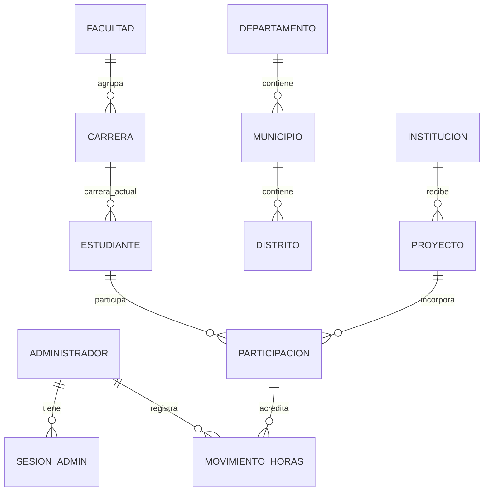

# Modelo de datos nuevo — propuesta para revisión

Revisión 0.1 · 26 de octubre de 2026 · Issue [#5](https://github.com/Luisnativii/ServicioHorasSociales/issues/5).

**Estado: PROPUESTA por bloques, salvo M10 revisión 0.2 aceptado el 28 de octubre mediante el contrato de acceso.** No es el modelo v0.2 recuperado. Los demás bloques, nombres, tipos, obligatoriedades, claves y restricciones requieren revisión; una regla funcional confirmada no aprueba automáticamente su representación física. No se fija una cantidad objetivo de tablas.

Origen: [fuentes F01–F04](FUENTES_Y_TRAZABILIDAD.md) y [reglas R01–R34](REGLAS_CONSOLIDADAS.md). Las alternativas abiertas se señalan como **PENDIENTE**, con su issue responsable. El esquema de negocio actual continúa vacío.

## Convenciones propuestas

| ID | Estado | Propuesta | Motivo y aprobación requerida |
| --- | --- | --- | --- |
| M01 | PROPUESTA | Esquema `horas_sociales`, nombres en singular y `snake_case`; PK UUID para entidades propias. | Reutilizar esquema inicial y guía de F01 etapa 03. No selecciona versión ni mecanismo de generación UUID. |
| M02 | PROPUESTA | `text` para carnet, correo, teléfono y extensión; `integer` para horas; `date` para fecha de actividad; `timestamptz` para instantes técnicos. | R16, R22 y R31; longitudes, validaciones, límites y zona de corte se aprueban aparte. |
| M03 | PROPUESTA | Relaciones FK conservadas, sin cascadas que borren historia. Desactivar catálogos usados en lugar de eliminarlos. | R07, R18 y R20; política precisa de borrado por entidad antes de migrar. |
| M04 | PROPUESTA | Datos derivados calculados a partir del libro; no guardar totales editables ni un booleano de cumplimiento manual. | R16, R22 y R25; consultas e índices se medirán en sus issues. |
| M05 | PROPUESTA | Validar restricciones locales en la base y reglas de varias filas mediante servicio transaccional. | R20, R23 y R24. El mecanismo de concurrencia se comprueba después con PostgreSQL real, no se acredita aquí. |

En las tablas siguientes «sí» o «no» expresa obligatoriedad **propuesta**, nunca aprobación implícita. Cada campo hereda el estado PROPUESTA del bloque. Una referencia PK/FK apunta a los nombres candidatos de este documento.

## M10 · Identidad administrativa

Actualización del 28 de octubre: el propietario aceptó [CONTRATO_ACCESO.md](CONTRATO_ACCESO.md), revisión 0.1, y M10 revisión 0.2: una sola tabla de administradores, sin sesiones/refresh. El bloque siguiente conserva el antecedente de revisión 0.1 y no debe implementarse por encima del contrato aceptado. Los demás bloques de este modelo continúan como propuesta.

Base funcional: R01–R06. Aprobación de contrato en #20 antes de #21–#29.

| Entidad.campo | Tipo | Obligatorio | Clave/restricción propuesta y propósito |
| --- | --- | --- | --- |
| `administrador.id` | `uuid` | Sí | PK. Varias filas permitidas, sin restricción de fila única. |
| `administrador.correo` | `text` | Sí | Identificador de acceso. Unicidad y normalización PENDIENTES en #20; no escoger todavía una función o índice definitivo. |
| `administrador.contrasena_hash` | `text` | Sí | Hash de contraseña; nunca contraseña ni token en claro. Algoritmo/parámetros en #20. |
| `administrador.activo` | `boolean` | Sí | Permite cero cuentas activas. No agregar restricción que impida desactivar la última. |
| `administrador.creado_en` / `actualizado_en` | `timestamptz` | Sí | Metadatos técnicos; origen y actualización por definir en contrato. |
| `sesion_admin.id` | `uuid` | Sí | PK e identificador de sesión. |
| `sesion_admin.administrador_id` | `uuid` | Sí | FK → `administrador.id`; sin borrar sesiones por cascada. |
| `sesion_admin.renovacion_hash` | `text` | Sí | Hash del token de renovación actual; representación y unicidad por definir en #20. |
| `sesion_admin.creada_en` / `vence_en` | `timestamptz` | Sí | Vencimiento absoluto posterior a creación. Duración PENDIENTE. |
| `sesion_admin.revocada_en` | `timestamptz` | No | Marca revocación; efectos y causa mínima por aprobar. |

Cardinalidad propuesta: `administrador 1 → 0..N sesion_admin`; cada sesión tiene un administrador. El rol ADMIN puede ser una capacidad fija de la aplicación: no se propone un catálogo editable de roles.

**PENDIENTE R06:** el esqueleto de sesión no resuelve aún rotación/reutilización. #20 debe definir familia, generaciones o registro de tokens consumidos, comparación atómica, revocación y limpieza antes de #22/#27. Tampoco se añade una tabla de recuperación pública. La herramienta #23 debe permitir recuperación cuando no haya cuentas activas, con operaciones explícitamente aprobadas.

Índices candidatos: búsqueda de sesiones por `administrador_id`; identificación por PK. El índice de correo y los relacionados con renovación se seleccionan con el contrato; no usar un diseño incompleto como SQL de identidad.

## M20 · Academia y territorio

Base funcional: R07–R08 y R16–R17. Bloques #34, #37, #40 y decisiones #7/#12.

| Entidad | Campos candidatos | Claves y restricciones propuestas |
| --- | --- | --- |
| `facultad` | `id uuid`, `nombre text`, `activo boolean` (todos obligatorios) | PK `id`; nombre no vacío. Unicidad normalizada del nombre por revisar. |
| `carrera` | `id uuid`, `facultad_id uuid`, `nombre text`, `activo boolean` (obligatorios) | PK `id`; FK `facultad_id` → `facultad.id`; definir si la unicidad del nombre es global o por facultad. |
| `genero` | `id uuid`, `nombre text`, `activo boolean` (obligatorios si se aprueba catálogo) | PK `id`; opciones y uso obligatorio/opcional en estudiante PENDIENTES. No precargar valores por intuición. |
| `departamento` | `id uuid`, `codigo text`, `nombre text` (obligatorios propuestos) | PK `id`; código oficial único solo con fuente aprobada. |
| `municipio` | `id uuid`, `departamento_id uuid`, `codigo text`, `nombre text` (obligatorios propuestos) | PK `id`; FK → `departamento.id`; ámbito de unicidad de código según fuente oficial. |
| `distrito` | `id uuid`, `municipio_id uuid`, `codigo text`, `nombre text` (obligatorios propuestos) | PK `id`; FK → `municipio.id`; ámbito de unicidad de código según fuente oficial. |

Cardinalidades propuestas: facultad 1 → N carreras; departamento 1 → N municipios; municipio 1 → N distritos. Cada hijo tiene un padre. La validez territorial y su nomenclatura se comprueban con la fuente de #37; no se inventan códigos ni semillas aquí.

Índices candidatos: columnas FK para búsquedas dependientes; nombres según filtros reales. Si se elige UUID como PK técnica territorial, conservar el código oficial con su ámbito documentado, sin convertir ambos en fuentes contradictorias.

## M30 · Instituciones y proyectos

Base funcional: R09–R15. Antes de persistir: aprobación de campos en #5/#6, contactos en #11, clasificación en #7 y cierre en #8.

| Entidad.campo | Tipo | Obligatorio | Clave/restricción propuesta y propósito |
| --- | --- | --- | --- |
| `institucion.id` | `uuid` | Sí | PK. «Organización» se tratará como este módulo si #6 confirma la terminología. |
| `institucion.nombre` | `text` | Sí | Nombre no vacío; política de duplicados por aprobar, sin imponer nombre global único. |
| `institucion.distrito_id` | `uuid` | Por acordar | FK → `distrito.id`, si la sede exige catálogo nacional. No resolver sedes desconocidas inventando distrito. |
| `institucion.direccion` | `text` | Por acordar | Dirección de sede, distinta de ejecución de proyecto. |
| `institucion.activo` | `boolean` | Sí | Desactivación sin borrar proyectos relacionados. |
| `proyecto.id` | `uuid` | Sí | PK. |
| `proyecto.institucion_id` | `uuid` | Sí | FK → `institucion.id`; una institución por proyecto. |
| `proyecto.nombre` | `text` | Sí | Nombre no vacío; no se presupone globalmente único. |
| `proyecto.descripcion` | `text` | Por acordar | Alcance del proyecto; contenido y longitud por revisar. |
| `proyecto.distrito_id` | `uuid` | Por acordar | FK → `distrito.id` para ejecución, independiente de la sede. |
| `proyecto.direccion_ejecucion` | `text` | Por acordar | Una ubicación física; formato y obligatoriedad por revisar. |
| `proyecto.naturaleza` | `text` controlado | Sí | `INTERNA` / `EXTERNA`; valor inicial EXTERNA. Cambios solo afectan movimientos nuevos. |
| `proyecto.estado` | `text` controlado | Sí | `ACTIVO`, `ABANDONADO`, `CANCELADO`, `FINALIZADO`; inicia ACTIVO. Transiciones mediante servicio, no solo lista de valores. |
| `proyecto.fecha_inicio` | `date` | Por acordar | No inferir fechas ni reglas de acreditación de este campo. |
| `proyecto.fecha_fin` | `date` | No en alta | Se exige al finalizar según R12; relación con otras fechas por aprobar en #8. |
| `proyecto.alumnos_solicitados` | `integer` | Por acordar | Si se registra, no negativo; valor informativo, nunca límite duro de participaciones. |

Cardinalidades propuestas: institución 1 → 0..N proyectos; proyecto → exactamente una institución. Sede y ejecución no comparten una fila mutable de dirección por deducción. Si se admite ubicación desconocida o externa al catálogo nacional, #5/#6 debe decidir su representación antes de migrar.

**PENDIENTE R11:** `contacto_institucion` y `contacto_proyecto` son dos candidatos separados; campos candidatos `id uuid`, FK al titular, `nombre text`, `correo text`, `telefono text`, `extension text`. #11 debe elegir número de contactos, campos obligatorios y si son personas reutilizables. No elegir un único responsable, exigir correo o crear una entidad global de persona sin esa decisión.

**PENDIENTE R11:** `coordinador` y `carrera_coordinador` representan una alternativa N:M; candidatos mínimos: coordinador con `id uuid` y `nombre text`; vínculo con `carrera_id uuid` y `coordinador_id uuid` (PK compuesta/FK). Campos de contacto, vigencia y relación con proyectos se deciden en #11. Un coordinador no referencia `administrador` por el hecho de existir.

**PENDIENTE R14:** catálogos candidatos `tipo_proyecto` y `area`, cada uno con `id uuid`, `nombre text`, `activo boolean`. Si #7 aprueba un tipo por proyecto, la alternativa es FK `proyecto.tipo_id`; si aprueba varios, tabla puente con PK `(proyecto_id, tipo_id)`. Análogamente, una sola área usaría FK `proyecto.area_id`; varias usarían `proyecto_area` con PK `(proyecto_id, area_id)`. No implementar ambas alternativas ni una dependencia área→tipo sin aprobación. Si se requiere historia, #12 definirá qué instantánea/versionado conservar.

Índices candidatos: `proyecto.institucion_id`, estado y los FK territoriales; clasificación solo después de seleccionar cardinalidades y consultas. No añadir índices de búsqueda ni restricciones de nombres que aún no tengan contrato.

## M40 · Estudiantes y participaciones

Base funcional: R16–R21. Campos definitivos y sus validaciones en #5/#6; historia en #12; estados individuales en #8.

| Entidad.campo | Tipo | Obligatorio | Clave/restricción propuesta y propósito |
| --- | --- | --- | --- |
| `estudiante.id` | `uuid` | Sí | PK. |
| `estudiante.carnet` | `text` | Sí | Único; conservar ceros. Normalización y longitud por ratificar. |
| `estudiante.nombres` / `apellidos` | `text` | Sí | No vacíos; nombres, límites y validaciones definitivas por revisar. |
| `estudiante.carrera_id` | `uuid` | Sí | FK → `carrera.id`. Facultad actual derivada de esa relación. |
| `estudiante.genero_id` | `uuid` | Por acordar | FK → `genero.id` solo si se aprueba el catálogo. No asignar un valor ficticio para cubrir faltantes. |
| `participacion.id` | `uuid` | Sí | PK. |
| `participacion.estudiante_id` | `uuid` | Sí | FK → `estudiante.id`. |
| `participacion.proyecto_id` | `uuid` | Sí | FK → `proyecto.id`. |
| `participacion.estado` | `text` controlado | Sí | ACTIVO/ABANDONADO constan en reglas; conjunto final y cierres PENDIENTES en #8. No inferir CANCELADO/FINALIZADO para todas las personas. |
| `participacion.asignada_en` | `timestamptz` | Sí | Instante técnico de asignación; separar de fecha efectiva si se aprueba otra fecha. |
| `participacion.cerrada_en` | `timestamptz` | No | Semántica y relación con cierre de proyecto por aprobar. |

Restricción candidata: `UNIQUE (estudiante_id, proyecto_id)`; abandono no elimina la fila ni permite nueva inscripción del mismo par. Cardinalidades: estudiante 1 → 0..N participaciones; proyecto 1 → 0..N participaciones; cada participación tiene exactamente un estudiante y un proyecto. No se fija máximo de personas usando `alumnos_solicitados`.

Índices candidatos: unicidad del carnet, unicidad del par e índice por `proyecto_id`/estado para consultar participantes. Búsqueda de nombres y paginación se definen en #56, con consultas reales.

**PENDIENTE R17/R30:** no almacenar una segunda facultad actual que pueda contradecir `carrera_id`. Conservar historia académica puede requerir una entidad con vigencias o una instantánea por movimiento; #12 debe escoger el significado temporal y el diseño antes de #55/#65.

## M50 · Libro de horas y saldos previos

Base funcional: R13, R22–R30. Acreditación ordinaria separada de saldos y correcciones.

| Entidad.campo | Tipo | Obligatorio | Clave/restricción propuesta y propósito |
| --- | --- | --- | --- |
| `movimiento_horas.id` | `uuid` | Sí | PK de acreditación ordinaria. |
| `movimiento_horas.participacion_id` | `uuid` | Sí | FK → `participacion.id`; estudiante/proyecto se obtienen por esta relación. |
| `movimiento_horas.horas` | `integer` | Sí | Mayor que cero para acreditación ordinaria; API rechaza decimales antes de convertir. Límites máximos por decidir. |
| `movimiento_horas.naturaleza` | `text` controlado | Sí | `INTERNA` / `EXTERNA` copiada al acreditar, sin recalcular movimientos antiguos desde el proyecto mutable. |
| `movimiento_horas.fecha_horas` | `date` | Sí | Fecha de actividad informada; rango permitido PENDIENTE en R28. |
| `movimiento_horas.registrado_en` | `timestamptz` | Sí | Captura técnica, distinta de la fecha de actividad. |
| `movimiento_horas.registrado_por` | `uuid` | Sí | FK → `administrador.id`; conservar actor aunque su cuenta se desactive. |
| `movimiento_horas.solicitud_id` | `uuid` | Sí | Único para idempotencia ordinaria. Ámbito definitivo de la clave por revisar en #66. |

Cardinalidad propuesta: participación 1 → 0..N movimientos; administrador 1 → 0..N movimientos registrados. No duplicar `estudiante_id`/`proyecto_id` sin una razón y restricción que evite contradicciones.

Índices candidatos: `(participacion_id, fecha_horas)`, fecha de actividad según filtros y unicidad de solicitud. Sumas acumuladas deben soportar acumulación superior al rango de una sola fila; elegir tipo de resultado y límites en el contrato, sin truncar excedentes al llegar a 300.

**PENDIENTE técnico de R24:** #66 debe conservar/comparar el contenido canónico de la solicitud o un registro de idempotencia equivalente. Una clave única por sí sola evita duplicados pero no detecta un cuerpo diferente. Resolver atomicidad, reintentos concurrentes y retención sin confundir conflicto con repetición válida.

**PENDIENTE R26:** candidato `saldo_previo` con `id uuid` PK, `estudiante_id uuid` FK, `naturaleza text`, `horas integer`, `fecha_corte date`, `procedencia text`, `registrado_en timestamptz`, `registrado_por uuid` FK e identificador de carga/solicitud por definir. #10 decide obligatoriedades, si cero se omite, granularidad, clave de unicidad y conciliación. No representar saldo desconocido con un proyecto, fecha o territorio ficticios ni crear un único saldo mutable sin procedencia.

**PENDIENTE R27:** no se añade un campo negativo ni una tabla de reverso como si ya estuvieran aprobados. #9 resolverá corrección, referencias al original, motivo, actor, fechas y tratamiento tras el cierre antes de #72.

**PENDIENTE R30:** campos de instantánea académica/clasificación se seleccionan en #12. Su ausencia en este borrador no autoriza a migrar el libro perdiendo historia requerida.

## M60 · Historiales y cálculos derivados

Base funcional: R12, R20–R23 y R29–R30.

Alternativas propuestas: `historial_proyecto` y `historial_participacion`, cada una con `id uuid` PK, FK al titular, `estado_anterior text`, `estado_nuevo text`, `registrado_en timestamptz`, `actor_id uuid` FK → `administrador.id` y `motivo text` si se exige. Obligatoriedad del motivo y fecha efectiva se deciden en #8; estados válidos de cada historial corresponden a su titular. Los cambios de estado y su evento se guardarán en una transacción.

No se propone una tabla de dashboard ni totales de estudiante editables. Avance por categoría se calcula sumando movimientos ordinarios, saldos aprobados y correcciones solo si se aprueban. Cumple cuando ambas categorías alcanzan su meta; el acumulado puede superar 300 en una categoría. Actividad de un período y cumplimiento histórico son consultas con contratos distintos.

## Relaciones principales propuestas

Diagrama conceptual de la propuesta; no representa tablas ya creadas ni resuelve los bloques abiertos.

Tipos/áreas, contactos, coordinadores, historia académica, saldos y correcciones se dejan fuera del diagrama principal hasta elegir sus alternativas. Las FK territoriales candidatas de sede y ejecución constan en M30; su obligatoriedad sigue pendiente.

## Aprobación por bloques y barreras de implementación

| Bloque | Estado de diseño | Falta decidir antes de SQL | Issues posteriores |
| --- | --- | --- | --- |
| M10 identidad | PROPUESTA | Contrato R06 y aceptación de campos/restricciones | #20 → #21–#29. |
| M20 academia/territorio | PROPUESTA | Nombres/obligatoriedades, unicidad, catálogo verificado y uso de género | #34 y #37; interfaces correspondientes. |
| M30 instituciones/proyectos | PROPUESTA | Campos, ubicación, contactos R11, clasificación R14 y fechas R21/R28 | #46, #48, #50 y #53. |
| M40 estudiantes/participaciones | PROPUESTA | Campos R17, estados R21 e historia R30 | #55, #56, #59 y #64. |
| M50 horas/saldos | PROPUESTA | Fechas R28, idempotencia, historia R30 y contrato de saldos R26 | #65–#69; correcciones solo tras #9. |
| M60 historia/reportes | PROPUESTA | Contrato de cierres y significado temporal de reportes | #53, #64, #74 y #75. |

Para aprobar un bloque, registrar el ID/revisión, aceptación o cambios solicitados, fecha y confirmación humana en #5 o en el issue de decisión correspondiente. La aprobación de un bloque no aprueba por arrastre los demás. No generar migraciones ni dar por cerrada una dependencia basándose únicamente en esta propuesta.
