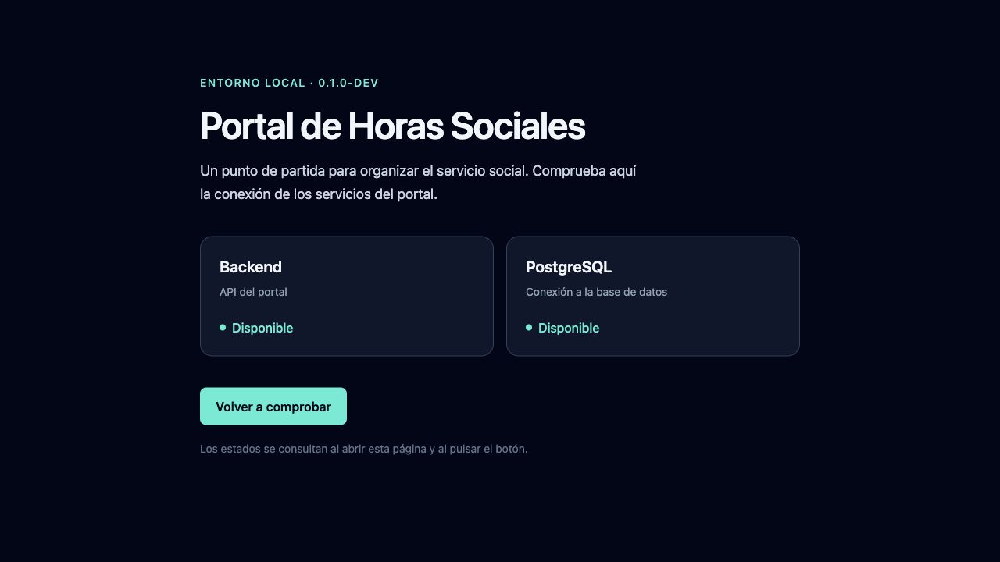

> Registro histórico de la inicialización local, anterior a publicar GitFlow. Las referencias `0.1.0-dev` y la ausencia de commits describen esa fase. La base publicada se normaliza a `V0.0.1`; consulta [GitFlow](GITFLOW.md) y las ejecuciones de [Actions](https://github.com/Luisnativii/ServicioHorasSociales/actions) para el estado actual.

# Evidencia de inicialización local

Fecha de ejecución: 25 de octubre de 2026, America/El_Salvador. Los logs de contenedores usan UTC y pueden mostrar 26 de octubre.

Esta evidencia sustituye el informe previo de preparación remota: ahora se ejecutó el proyecto directamente en la Mac del usuario, en `/Users/luisnativii/Desktop/horas-sociales`.

## Entorno comprobado

- macOS / Darwin ARM64. Docker ejecuta Linux ARM64, sin forzar emulación AMD64.
- Docker Desktop 4.92.0; Engine 29.8.0; Compose 5.5.1; Git 2.54.0.
- No había repositorio Git en esta carpeta; se inicializó la rama `main`, sin commits, tags ni configuración de identidad.
- Se conservaron los archivos existentes y se corrigieron sobre la misma estructura. No se tocaron los otros proyectos de Docker del equipo.
- No se instaló Go, Node, npm ni PostgreSQL en macOS.

## Resultados comprobados

| Comprobación | Resultado y evidencia |
| --- | --- |
| Imágenes de desarrollo | `hs-api:0.1.0-dev`, `hs-web:0.1.0-dev`, `hs-migrator:0.1.0-dev` construidas para linux/arm64 |
| Arranque | db, api y web alcanzaron estado healthy con `up --wait` |
| Puerto local | Solo web publica `127.0.0.1:8080`; API y base sin puertos publicados |
| Inicialización | Configuración nueva en carpeta desechable y repetida comprobadas; permisos 600; secretos y lockfiles existentes conservaron su hash |
| Migración | Goose aplicó `00001_schema.sql`; repetir `up` informó sin migraciones pendientes, versión 1; `status` mostró una sola migración aplicada |
| Estructura PostgreSQL | Esquema `horas_sociales` presente; única tabla no perteneciente al sistema: `public.goose_db_version` |
| Frontend real | Navegador en `127.0.0.1:8080`; React renderizado con Tailwind y ambos servicios disponibles |
| HTTP desde el host | `localhost:8080/api/health/live` y `/api/health/ready` devolvieron 200 y `{"status":"ok"}` |
| Caída PostgreSQL | `stop db`: liveness 200, readiness 503 y `{"status":"unavailable"}`; pantalla mostró Backend disponible, PostgreSQL no disponible y aviso |
| Recuperación | Al iniciar db y volver a comprobar, readiness 200 y ambos servicios disponibles, sin reiniciar la API |
| Carga y timeout | Pausa temporal real de la API: interfaz «Comprobando…», botón deshabilitado y luego aviso de backend no disponible tras 5 s; al reanudar y comprobar volvió a disponible |
| Persistencia | Dato de prueba en esquema exclusivo sobrevivió `down` y `up`; misma fecha de creación del volumen `hs-dev_pgdata`; solo se retiró el esquema de prueba |
| Recarga React | Edición temporal del texto apareció en el DOM del navegador sin recargar ni reconstruir; se restauró el archivo |
| Recarga Go | Cabecera temporal `X-HS-Reload: verified` apareció en HTTP sin reconstrucción; se restauró el archivo |
| Error durante recarga | Archivo Go inválido produjo error de compilación y la API anterior siguió respondiendo 200; se retiró el archivo temporal |
| Go | Formato, módulos, vet, pruebas con `-race` y compilación dentro de Docker |
| Frontend | TypeScript `tsc --noEmit` y build Vite dentro de Docker |
| Runtime sin root | API UID 65532 y web UID 101; frontend compilado servido por Nginx y ambos endpoints reales a través de su proxy |
| Limpieza runtime | Proyecto local temporal `hs-runtime-check` retirado; sin puertos externos ni volumen propio |
| Secretos | `.env` con permisos 600 e ignorado por Git; no se imprimieron contraseñas ni cadenas de conexión |
| Seguridad npm | npm audit: 0 vulnerabilidades conocidas |
| Seguridad Go | govulncheck 1.9.0: `No vulnerabilities found.` tras corregir x/text |

La revisión Go inicial detectó [GO-2026-6629](https://pkg.go.dev/vuln/GO-2026-6629) y [GO-2026-5970](https://pkg.go.dev/vuln/GO-2026-5970) en `golang.org/x/text` 0.29.0, dependencia indirecta de pgx. Se fijó 0.41.0, se regeneraron go.mod/go.sum dentro de Docker y se reconstruyeron las imágenes antes de repetir la validación.

La revisión de vulnerabilidades refleja las bases consultadas en esta fecha; los scripts permiten repetirla.

## Repetir las comprobaciones

Desde la raíz del repositorio, con el entorno iniciado:

```bash
bash scripts/check.sh
bash scripts/check-integration.sh
bash scripts/check-runtime.sh
bash scripts/check-security.sh
```

Ejecutarlas en secuencia: la prueba de integración detiene servicios temporalmente. Todos los compiladores y dependencias de comprobación se ejecutan dentro de contenedores.



## Validación manual pendiente

- Revisar el aspecto de la interfaz en el navegador que utilizarás y en vista móvil.
- Pulsar «Volver a comprobar» y confirmar Backend/PostgreSQL disponibles.
- Revisar estructura, decisiones y resumen del primer commit.

No quedan bloqueos de ejecución local. El commit inicial y el tag `v0.1.0`, las etiquetas definitivas `0.1.0` y cualquier despliegue externo siguen pendientes de tu validación. No hay autenticación, tablas de negocio, formularios administrativos ni dashboard.
